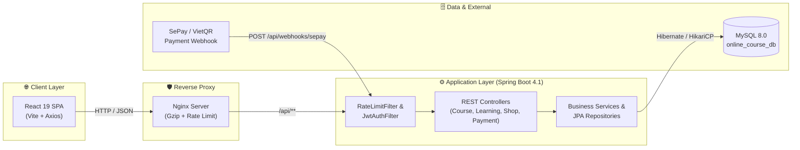

<div align="center">

# 🎓 EduHub — Nền Tảng Quản Lý & Bán Khóa Học Trực Tuyến

**Hệ thống E-Learning & E-Commerce Fullstack chuẩn Production với Java Spring Boot, React 19, MySQL 8.0 & Thanh toán tự động VietQR (SePay)**

[](https://openjdk.org/)
[](https://spring.io/projects/spring-boot)
[](https://react.dev/)
[](https://vitejs.dev/)
[](https://www.mysql.com/)
[](https://www.docker.com/)
[](LICENSE)

[✨ Tính năng](#-tính-năng-nổi-bật) •
[🏗️ Kiến trúc](#️-kiến-trúc-hệ-thống) •
[🚀 Cài đặt nhanh](#-hướng-dẫn-cài-đặt--khởi-chạy) •
[🛡️ Bảo mật & Kiểm thử](#️-bảo-mật--kiểm-thử-tự-động) •
[📚 Tài liệu](#-tài-liệu-kỹ-thuật--đặc-tả) •
[👥 Thành viên](#-thành-viên--phân-công)

</div>

---

## 📖 Giới thiệu

**EduHub (`online-course`)** là nền tảng học trực tuyến kết hợp thương mại điện tử (E-Learning & E-Commerce) được xây dựng theo quy trình **Software Development Life Cycle (SDLC)** chuẩn công nghiệp. Hệ thống giải quyết trọn vẹn vòng đời từ lúc học viên khám phá khóa học, xem thử bài giảng miễn phí, áp mã giảm giá, thanh toán quét mã **VietQR / SePay** thời gian thực, đến theo dõi tiến độ học tập thông minh và nhận chứng chỉ hoàn thành.

---

## ✨ Tính năng nổi bật

<table>
  <tr>
    <td width="50%" valign="top">
      <h3>🎬 Trải nghiệm Học tập Thông minh</h3>
      <ul>
        <li><b>Học thử miễn phí (Free Preview):</b> Cho phép xem thử bài giảng đầu tiên ngay tại trang chi tiết khóa học trước khi mua.</li>
        <li><b>Smart Video Player:</b> Tự động lưu vị trí giây đang xem (<i>Resume Playback</i>), điều chỉnh tốc độ phát (<code>0.75x</code> – <code>2x</code>) và hỗ trợ phím tắt (<code>Space</code>, <code>←</code>, <code>→</code>).</li>
        <li><b>Tự động hoàn thành (Auto-Complete):</b> Tự động đánh dấu hoàn thành bài học khi thời lượng xem đạt <code>≥ 80%</code>.</li>
        <li><b>Chứng chỉ & Đánh giá:</b> Cấp chứng chỉ hoàn thành khi đạt <code>100%</code> tiến độ và cho phép xếp hạng sao / bình luận.</li>
      </ul>
    </td>
    <td width="50%" valign="top">
      <h3>💳 Thương mại Điện tử & Thanh toán VietQR</h3>
      <ul>
        <li><b>Giỏ hàng & Yêu thích:</b> Đồng bộ trạng thái giỏ hàng, danh sách khóa học yêu thích và lịch sử đơn hàng.</li>
        <li><b>Hệ thống Voucher linh hoạt:</b> Hỗ trợ mã giảm giá theo phần trăm (<code>PERCENT</code>) hoặc số tiền cố định (<code>FIXED</code>), kiểm tra hạn dùng & đơn tối thiểu.</li>
        <li><b>Cổng thanh toán VietQR / SePay:</b> Sinh mã QR động theo chuẩn Napas247 kèm nội dung chuyển khoản định danh đơn hàng (<code>DH...</code>).</li>
        <li><b>Đối soát tự động (Webhook + Polling):</b> Tự động kích hoạt khóa học ngay khi nhận biến động số dư qua Webhook SePay.</li>
      </ul>
    </td>
  </tr>
  <tr>
    <td width="50%" valign="top">
      <h3>🛡️ Bảo mật Đa tầng (DevSecOps)</h3>
      <ul>
        <li><b>Xác thực Stateless JWT & BCrypt:</b> Phân quyền chặt chẽ theo vai trò (<code>ADMIN</code>, <code>INSTRUCTOR</code>, <code>STUDENT</code>).</li>
        <li><b>Chống DoS / Brute-force (Rate Limiting):</b> Giới hạn tần suất request theo IP ở cả tầng Nginx và Spring Boot Filter (<code>429 Too Many Requests</code>).</li>
        <li><b>Chống SQL Injection & XSS:</b> Truy vấn tham số hóa qua Spring Data JPA kết hợp HTTP Security Headers (<code>nosniff</code>, <code>X-Frame-Options: DENY</code>).</li>
        <li><b>Bảo vệ nội dung số:</b> Ẩn đường dẫn video gốc với người dùng chưa ghi danh (<code>403 Forbidden</code>).</li>
      </ul>
    </td>
    <td width="50%" valign="top">
      <h3>📊 Quản trị Hệ thống Toàn diện (Admin)</h3>
      <ul>
        <li><b>Dashboard Thống kê:</b> Biểu đồ và số liệu tổng quan về học viên, khóa học, lượt ghi danh và doanh thu.</li>
        <li><b>Quản lý Danh mục & Khóa học:</b> CRUD danh mục, khóa học, bài học với cơ chế xóa mềm (<i>Soft Delete</i>) bảo toàn dữ liệu lịch sử.</li>
        <li><b>Quản lý Chiến dịch Marketing:</b> Quản trị Banner trình chiếu trang chủ và phát hành mã giảm giá (Voucher).</li>
        <li><b>Skeleton Loading UI:</b> Hiệu ứng tải trang mượt mà đồng bộ trên toàn bộ giao diện người dùng và quản trị.</li>
      </ul>
    </td>
  </tr>
</table>

---

## 🏗️ Kiến trúc Hệ thống



### 📂 Cấu trúc Thư mục

```text
online-course/
├── backend/                        # Spring Boot 4.1 RESTful API (Java 21)
│   ├── src/main/java/.../backend/
│   │   ├── config/                 # SecurityConfig, CORS, OpenAPI, Seeder
│   │   ├── controller/             # REST Controllers (Auth, Course, Learning, Payment...)
│   │   ├── dto/                    # Request & Response DTOs (@Valid)
│   │   ├── entity/                 # JPA Entities (User, Course, Lesson, Enrollment, Voucher...)
│   │   ├── exception/              # GlobalExceptionHandler & Custom Exceptions
│   │   ├── repository/             # Spring Data JPA Repositories
│   │   ├── security/               # JwtService, JwtAuthenticationFilter, RateLimitFilter
│   │   └── service/                # Business Logic Layer
│   ├── src/test/                   # JUnit 5 & MockMvc Integration Tests
│   └── Dockerfile                  # Multi-stage Production Build (Maven -> JRE 21)
├── frontend/                       # React 19 Single Page Application (Vite)
│   ├── src/
│   │   ├── api/                    # Axios Client & API Modules
│   │   ├── components/             # Design System UI Kit (Skeleton, CourseCard, Modal...)
│   │   ├── contexts/               # AuthContext & Global State
│   │   ├── pages/                  # Trang Học viên, Thanh toán, Học tập & Admin
│   │   ├── styles/                 # CSS Variables (Tokens), Layout & Page Styles
│   │   └── utils/                  # Formatters, Shop Store & Unit Tests
│   ├── nginx.conf                  # Cấu hình Nginx Production (SPA Fallback + Security)
│   └── Dockerfile                  # Multi-stage Production Build (Node -> Nginx Alpine)
├── docs/                           # Tài liệu API & Luồng dữ liệu chi tiết
├── docker-compose.yml              # Khởi chạy nhanh MySQL & Adminer cho môi trường Dev
├── docker-compose.prod.yml         # Đóng gói toàn bộ hệ thống chuẩn Production
└── LICENSE                         # Giấy phép mã nguồn mở MIT
```

---

## 🚀 Hướng dẫn Cài đặt & Khởi chạy

### Yêu cầu môi trường
* **Docker & Docker Compose** (để chạy MySQL 8.0 hoặc toàn bộ stack)
* **JDK 21+** (hoặc dùng Maven Wrapper `./mvnw` đi kèm)
* **Node.js 20+** & **npm**

### Cách 1: Chạy môi trường Phát triển (Local Development)

**Bước 1: Khởi động MySQL Database qua Docker**
```bash
docker compose up -d
```
* **MySQL:** `localhost:3306` — Database: `online_course_db` | User: `root` | Password: `course123`
* **Adminer (Quản trị DB trên Web):** [http://localhost:8082](http://localhost:8082)

**Bước 2: Khởi động Backend (Spring Boot)**
```bash
cd backend
./mvnw spring-boot:run
```
* **Backend API:** [http://localhost:8080](http://localhost:8080)
* **Swagger UI (Tài liệu API tương tác):** [http://localhost:8080/swagger-ui/index.html](http://localhost:8080/swagger-ui/index.html)

**Bước 3: Khởi động Frontend (React + Vite)**
```bash
cd frontend
npm install
npm run dev
```
* **Giao diện Web:** [http://localhost:5173](http://localhost:5173)
* **Bộ UI Kit & Design System:** [http://localhost:5173/ui-kit](http://localhost:5173/ui-kit)

---

### Cách 2: Triển khai Chuẩn Production (Full Docker Compose)

Khởi chạy đồng thời **MySQL 8.0 + Spring Boot Backend + Nginx Frontend** chỉ với 1 lệnh:

```bash
docker compose -f docker-compose.prod.yml up -d --build
```

<details>
<summary><b>⚙️ Xem danh sách Biến môi trường Production (<code>.env</code>)</b></summary>

 Tạo file `.env` tại thư mục gốc trước khi chạy `docker-compose.prod.yml`:

```env
# Database Configuration
MYSQL_ROOT_PASSWORD=your_strong_db_password
MYSQL_DATABASE=online_course_db
DB_USERNAME=root
DB_PASSWORD=your_strong_db_password

# JWT & CORS Security
JWT_SECRET=your_256_bit_base64_encoded_jwt_secret_key
JWT_EXPIRATION=86400000
CORS_ALLOWED_ORIGINS=http://localhost

# SePay / VietQR Payment Gateway
SEPAY_BANK_CODE=MB
SEPAY_BANK_NAME=MBBank (Ngân hàng Quân Đội)
SEPAY_ACCOUNT_NUMBER=0379284950
SEPAY_ACCOUNT_NAME=EDU HUB ACADEMY
SEPAY_WEBHOOK_API_KEY=your_sepay_webhook_secret_key
```
</details>

---

## 🛡️ Bảo mật & Kiểm thử Tự động

Hệ thống được trang bị bộ kiểm thử tự động ở cả Backend và Frontend nhằm đảm bảo chất lượng trước mỗi lần phát hành:

### 1. Chạy Integration Tests & Security Tests (Backend)
Kiểm tra toàn bộ luồng tạo đơn hàng, đối soát Webhook SePay, chống **SQL Injection** và kiểm증 bộ lọc **Rate Limiting (`429 Too Many Requests`)**:
```bash
cd backend
./mvnw test
```

### 2. Chạy Unit Tests (Frontend)
Kiểm tra logic giỏ hàng, tính toán mã giảm giá (`PERCENT`/`FIXED`), danh sách yêu thích và quản lý trạng thái đơn hàng chờ thanh toán:
```bash
cd frontend
npm test
```

<details>
<summary><b>🔌 Xem danh sách các nhóm API chính (RESTful Endpoints)</b></summary>

| Nhóm chức năng | Phương thức & Đường dẫn | Quyền truy cập | Mô tả |
| :--- | :--- | :--- | :--- |
| **Xác thực** | `POST /api/auth/register`<br>`POST /api/auth/login` | Public (Rate Limited) | Đăng ký tài khoản & Đăng nhập nhận JWT |
| **Khóa học** | `GET /api/courses`<br>`GET /api/courses/{id}` | Public | Tìm kiếm, lọc khóa học & xem chi tiết kèm mục lục |
| **Học tập** | `GET /api/courses/{id}/learning`<br>`POST /api/lessons/{id}/progress` | `STUDENT` (Enrolled) | Lấy video bài giảng & cập nhật tiến độ học tập |
| **Thanh toán** | `GET /api/payment/config`<br>`POST /api/orders/pending`<br>`GET /api/orders/{code}/status`<br>`POST /api/webhooks/sepay` | Public / `STUDENT` / Webhook | Cấu hình VietQR, tạo đơn chờ, polling trạng thái & nhận Webhook SePay |
| **Khuyến mãi** | `GET /api/banners/active`<br>`POST /api/vouchers/validate` | Public | Lấy banner trang chủ & kiểm tra mã giảm giá |
| **Quản trị** | `/api/admin/courses/**`<br>`/api/admin/vouchers/**`<br>`/api/admin/banners/**` | `ADMIN` | Quản trị toàn diện khóa học, học viên, voucher & banner |

</details>

---

## 📚 Tài liệu Kỹ thuật & Đặc tả

* 📘 [Tài liệu Bàn giao Nền tảng & Kiến trúc Hệ thống (`HANDOVER_GUIDE.md`)](HANDOVER_GUIDE.md)
* 📋 [Đặc tả Module Quản lý Khóa học — TV2 (`TASK_TV2_COURSE_MANAGEMENT.md`)](TASK_TV2_COURSE_MANAGEMENT.md)
* 📋 [Đặc tả Module Học tập, Đánh giá & Quản trị — TV3 (`TASK_TV3_LEARNING_SYSTEM.md`)](TASK_TV3_LEARNING_SYSTEM.md)
* 🔌 [Tài liệu Đặc tả API Khóa học (`docs/course-api.md`)](docs/course-api.md)
* 🔄 [Sơ đồ Luồng Dữ liệu Hệ thống (`docs/course-data-flow.md`)](docs/course-data-flow.md)

---

## 👥 Thành viên & Phân công

| Thành viên | Vai trò & Phụ trách | Các bảng CSDL chính | Nhánh phát triển |
| :--- | :--- | :--- | :--- |
| **TV1 (Team Leader)** | Core Architecture, Database, Authentication & Security | `users` | `feature/auth-core` |
| **TV2** | Course Management, E-Commerce, Payment, Docker & DevSecOps | `categories`, `courses`, `lessons`, `vouchers`, `banners` | `feature/course` / `chore/docker-prod` |
| **TV3** | Learning System, Video Progress, Reviews & Admin Portal | `enrollments`, `lesson_progress`, `reviews` | `feature/learning-admin` |

---

<div align="center">

Được phát triển với ❤️ bởi **Nhóm Đồ án Công nghệ Phần mềm (CNPM-TNT)** • Phân phối dưới giấy phép [MIT License](LICENSE).

</div>
